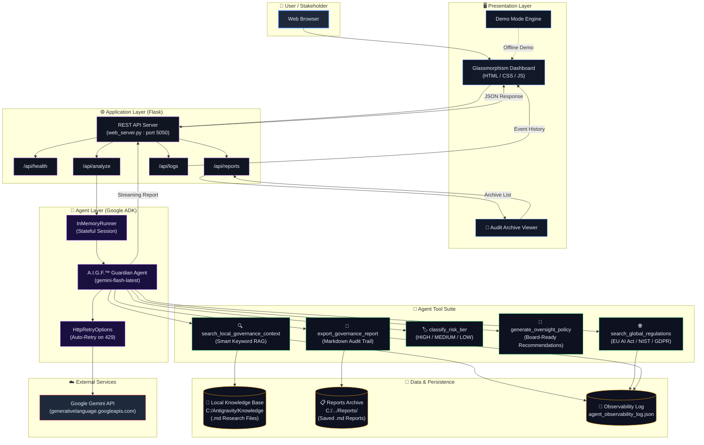

# A.I.G.F.™ Governance Guardian

> **Google Startups AI Agent Challenge 2026 — Track 1 Submission**
> Built by **AI For People** (Maurice Rankin)

---

## 🎯 Public Red-Team Jailbreak Challenge
We have initiated an open-arena security bounty on our 5-layer defensive stack! Can you bypass the Pre-Scanner, XML Isolation, Identity Lock, Risk Classifier, or Output Scanner?
* 📜 **Challenge Rules & Scope:** Read the [CHALLENGE.md](CHALLENGE.md)
* 🚀 **Submit Verified Payloads:** Open a [Bounty Submission Issue](https://github.com/mlrankinseattle/aigf-governance-guardian/issues/new?template=adversarial_payload_submission.md)

---
## 🎯 Project Title
**A.I.G.F.™ Governance Guardian** — Autonomous AI Governance Auditing Agent

## 🔥 Problem to Solve
As AI development accelerates, there is a dangerous **"Governance Gap"** — startups and research labs are deploying powerful models without real-time, expert oversight. Manual compliance checks are too slow for the age of AI, leaving organizations vulnerable to the **EU AI Act**, data privacy breaches (PII), and "hallucinated" policy adherence.

## 💡 Our Solution
The **A.I.G.F.™ Governance Guardian** is an autonomous AI agent built on the **Google Agent Development Kit (ADK)** that provides "Dual-Grounded" oversight.

Unlike a static checklist, the Guardian is a **live agent** that:
- 🔍 **Grounded Auditing** — Smart Keyword Search against private internal research (Local RAG)
- 🌐 **Regulatory Intelligence** — Cross-references with EU AI Act, NIST, GDPR
- 🏷️ **Automated Risk Tiering** — HIGH / MEDIUM / LOW classification with custom Oversight Policies
- 🔎 **Production Observability** — Full JSON Audit Trail for every agent decision
- ⚡ **Resilient Design** — Auto-retry on API rate limits, Demo Mode, premium web dashboard

## 🏗️ Architecture



### Data Flow Summary

| Step | Component | Action |
|------|-----------|--------|
| 1 | **User** | Enters project description + data types via web form |
| 2 | **Flask API** | Receives POST to `/api/analyze`, initializes ADK agent |
| 3 | **Guardian Agent** | Gemini selects tools autonomously based on instructions |
| 4 | **Tool: Local RAG** | Smart keyword search across private `.md` knowledge files |
| 5 | **Tool: Global Regs** | Cross-references against EU AI Act, NIST, GDPR databases |
| 6 | **Tool: Risk Tier** | Classifies project as HIGH / MEDIUM / LOW risk |
| 7 | **Tool: Policy Gen** | Generates board-ready oversight recommendations |
| 8 | **Tool: Export** | Saves final report to local audit trail as `.md` |
| 9 | **Observability** | Every tool call logged to `agent_observability_log.json` |
| 10 | **Response** | Streaming report rendered in the web dashboard |

## 🛠️ Tech Stack
| Component | Technology |
|-----------|-----------|
| Agent Framework | Google Agent Development Kit (ADK) |
| LLM | Gemini Flash (via `InMemoryRunner`) |
| Backend | Python / Flask |
| Frontend | Vanilla HTML / CSS / JS (Glassmorphism) |
| Grounding | Local Markdown RAG + Regulatory DB |
| Observability | JSON Audit Event Logger |
| Security | 5-Layer Defense Stack (Input Scanner, Identity Lock, XML Isolation, Risk Classifier, Output Scanner) |

## 🚀 Quick Start

### Prerequisites
- Python 3.10+
- A Gemini API Key ([Get one here](https://aistudio.google.com/))

### Installation
```bash
cd AI4People_Challenge
python -m venv venv
# Windows:
.\venv\Scripts\Activate.ps1
# macOS/Linux:
source venv/bin/activate

pip install -r requirements.txt
```

### Run the Web Dashboard
```bash
python web_server.py
```
Open your browser to: **http://localhost:5050**

### Run the CLI Agent
```bash
python agent.py
```

## 📁 Project Structure
```
AI4People_Challenge/
├── web_server.py              # Flask API + ADK Agent (Web Mode)
├── agent.py                   # CLI Agent (Standalone)
├── agent_stable_v2.py         # Stable V3.1 Backup
├── requirements.txt           # Python Dependencies
├── submission_summary.md      # Challenge Submission Details
├── architecture_diagram.md    # System Architecture (Mermaid)
├── agent_observability_log.json  # Live Audit Trail
├── AIGF_Security_ChangeLog_v3.docx  # Security Hardening Change Log
├── web/
│   ├── index.html             # Dashboard UI
│   ├── style.css              # Premium Dark Theme
│   └── app.js                 # Frontend Logic
├── Reports/                   # Saved Governance Reports
└── Knowledge/                 # Local RAG Knowledge Base (Markdown)
```

## 🎬 Demo Video
[Watch the Demo →](YOUR_VIDEO_LINK_HERE)

## 📋 Key Features Demonstrated
1. **Security Gate** — API key input with show/hide toggle
2. **Live Tool Timeline** — Watch the agent think in real-time
3. **Risk Badge** — Auto-detected HIGH / MEDIUM / LOW classification
4. **Audit Archive** — Clean, rolling list of the 5 most recent reports (older reports automatically fall off the list)
5. **Export** — Download any report as `.md`
6. **Demo Mode** — Full UI walkthrough without API connection
7. **Rate Limit Resilience** — Graceful 30-second countdown on 429 errors
8. **Cache-Prevention System** — Core client-and-server-side cache busting ensuring real-time dashboard updates without manual browser/server refreshes.

## 🔐 Responsible AI Alignment
This agent is built on **Google's AI Principles**:
- **Safety**: Risk tiering prevents unaudited deployments
- **Accountability**: Every agent decision is logged
- **Privacy**: API keys are never stored; local RAG keeps data private
- **Security**: 5-layer prompt injection defense stack validated via live red-team testing (Aug 20, 2026)

---

## 🤝 Security Peer Review & Acknowledgments

Special thanks to **Nathan Freestone ([The Elora Taurus Project](https://ai.elorataurus.com/engineering#open-source-research))** for independent static code review and responsible disclosure contributions leading to the v3.2 security hardening release.

---
## 📜 License

This project is protected under a **Custom Proprietary License**.

- Viewing, testing, and academic use is permitted with attribution.
- Commercial use, redistribution, or derivative products require written permission.
- The **A.I.G.F.™** name and brand are trademarks of AI For People.

See the [LICENSE](LICENSE) file for full terms.

For commercial licensing inquiries: [ai4people.info](https://ai4people.info)

---

**© 2026 AI For People** | [ai4people.info](https://ai4people.info)
