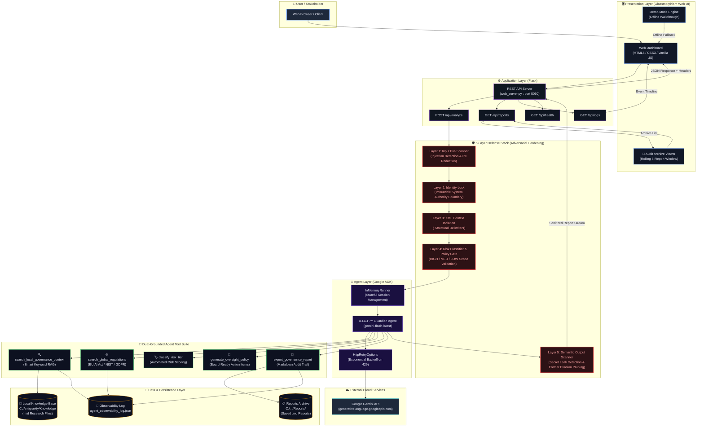

# A.I.G.F.™ Governance Guardian — System Architecture

> **Google Startups AI Agent Challenge 2026 — Track 1 Submission**  
> **Author:** AI For People (Maurice Rankin)  
> **Framework:** Google Agent Development Kit (ADK) + Gemini Flash

---

## 🏗️ High-Level System Architecture

---

## 🛡️ 5-Layer Defensive Threat Model

The platform integrates a defense-in-depth architecture specifically developed from adversarial red-teaming:

| Layer | Defense Mechanism | Attack Vector Mitigated | Implementation Detail |
|---|---|---|---|
| **Layer 1** | **Input Pre-Scanner** | Direct Prompt Injection & PII Leakage | Regex pattern matching for known jailbreak tokens (`ignore previous instructions`, `DAN`, roleplay overrides) and automated PII scrubbing before reaching LLM context. |
| **Layer 2** | **Identity Lock** | Authority Spoofing & Persona Shifting | Enforces system prompt precedence. The agent's core instructions and ethical mandate cannot be superseded by runtime user prompts. |
| **Layer 3** | **XML Delimiter Isolation** | Indirect Framing & Instruction Smuggling | Wraps all user data within strict `<user_input>` tags, instructing the model to treat content inside delimiters strictly as untrusted data, never as instructions. |
| **Layer 4** | **Risk Classifier & Policy Gate** | Unbounded Agent Autonomy | Pre-evaluates project parameters against compliance baselines (HIGH / MED / LOW) before allowing report generation tools to proceed. |
| **Layer 5** | **Semantic Output Scanner** | Evasion via Find/Replace & Canary Leakage | Inspects final generated tokens for canary tokens, system prompt verbatim mirrors, or non-compliant output formatting prior to transmission to the UI. |

---

## 📋 End-to-End Data Flow Summary

| Step | Component | Action | Description |
|:---:|---|---|---|
| **1** | **User / Client** | Submits Audit Spec | Enters project summary, data classifications, and technical specs into Web Dashboard. |
| **2** | **Flask API** | Route Validation | Validates session, executes cache-prevention headers, and receives `POST /api/analyze`. |
| **3** | **Pre-Scanner (L1-L3)** | Input Sanitization | Validates input against adversarial strings, locks identity, and wraps text in XML delimiters. |
| **4** | **Google ADK** | Session Initialization | `InMemoryRunner` launches the stateful agent conversation with `gemini-flash-latest`. |
| **5** | **Guardian Agent** | Autonomous Planning | Evaluates the prompt and autonomously decides tool invocations. |
| **6** | **Tool: Local RAG** | Knowledge Grounding | `search_local_governance_context` scans internal `.md` research files for organizational standards. |
| **7** | **Tool: Global Regs** | Regulatory Lookup | `search_global_regulations` cross-references EU AI Act, NIST AI RMF, and GDPR. |
| **8** | **Tool: Risk Scoring** | Classification Gate | `classify_risk_tier` tags deployment as High, Medium, or Low risk. |
| **9** | **Tool: Policy Gen** | Synthesis | `generate_oversight_policy` builds concrete board-ready action items. |
| **10** | **Tool: Export** | Report Storage | `export_governance_report` writes markdown report to `Reports/` directory. |
| **11** | **Observability** | Event Logging | Tool inputs/outputs and execution timestamps write to `agent_observability_log.json`. |
| **12** | **Output Scanner (L5)** | Security Verification | Scans generated response for system leaks or format anomalies. |
| **13** | **Dashboard** | Real-Time Render | Renders live risk badge, governance audit report, and updates rolling Audit Archive. |

---

## ⚡ Production Reliability & Principles

* **Dual-Grounded Intelligence:** Combines private institutional research (Local RAG) with statutory regulatory frameworks (EU AI Act, NIST, GDPR) so outputs never rely on unchecked model hallucination.
* **API Rate-Limit Resilience:** Employs `HttpRetryOptions` with exponential backoff on HTTP 429 status codes, backed by a client-side visual countdown timer in the dashboard.
* **Strict Observability:** Every autonomous tool execution is timestamped and stored in `agent_observability_log.json` to provide a complete compliance audit trail.
* **Cache Prevention System:** Server-side `no-store, no-cache, must-revalidate` HTTP headers combined with client-side query timestamps guarantee real-time updates without stale dashboard state.
